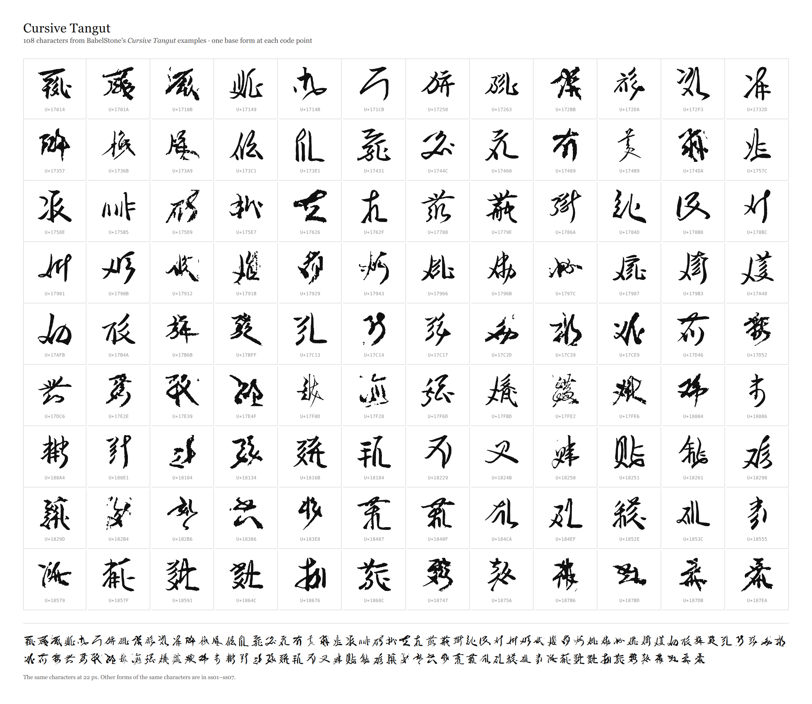

# Cursive Tangut forms

The 108 Tangut characters for which BabelStone's [Cursive
Tangut](https://www.babelstone.co.uk/Tangut/CursiveTangut.html) page shows cursive forms, with the
210 forms traced to outlines. [Andrew West](https://www.babelstone.co.uk/Tangut/) compiled the
[table](https://www.babelstone.co.uk/Tangut/CursiveExamples.html) from Arakawa Shintaro's 2016
report and from manuscript photographs. The page was last modified 2020-07-01 and was read on
2026-11-07.

`forms.json.gz` holds one record per form:

| field | meaning |
| --- | --- |
| `char`, `codepoint` | the character and its Unicode code point |
| `meaning`, `references` | the page's gloss, and its Li Fanwen (`L…`) and Kychanov (`K…`) numbers |
| `source` | the title the page gives the crop, kept verbatim |
| `image`, `sha256`, `width`, `height` | the file on the page, its digest, and the crop's size |
| `crop` | the part of the crop the trace used, as fractions of its width and height, present when a strip of the next character was cut away |
| `order` | the form's position in the page's row |
| `base`, `alternate` | whether this form stands at the code point, or its `ss01`–`ss07` set |
| `outline` | `M`, `L`, `C` and `Z` commands in font units |

The outlines use a 1000-unit em, a baseline at 0, and an ink box 880 units on its longest side
centred at (500, 372). That is the box of Noto Serif Tangut's own glyphs, so the two faces set at
the same size sit together.

## Sources

- 荒川慎太郎 (ARAKAWA Shintaro). *ロシア所蔵資料の実見調査に基づく西夏文字草書体の体系的研究*
  (*Systematic Studies on the Tangut Script in Running Form, Based on the Research of Original
  Tangut Materials Preserved in Russia*). 東京外国語大学・アジア・アフリカ言語文化研究所, 2016.
  Appendix pp. 87–93 by 小野裕子 (ONO Hiroko); the page's crops come from pp. 89–93. The sixty
  characters in it are from *Hàinián Xīnfǎ* 亥年新法 manuscripts (IOM Inv. Nos. 6092, 5946 and
  6549), and all but one have two forms.
- Baisigou Fangta 百寺溝方塔 manuscripts: F056-1, F056-2-1 to F056-2-4, F056-2-15, F056-2-17,
  F056-3-4 and F065-1. The page spells the name *Baisgou Fangta*; its spelling is kept in the
  source titles.
- Institute of Oriental Manuscripts, St Petersburg: Tang. 334/134, 248, 259, 260, 263 and 311, and
  Inv. No. 4597. The page leaves one Tang. 334 number as `???`.
- British Library Or.12380/2047.
- *Classic of Filial Piety* (孝經), p. 194.
- `G31・003`, which the page does not identify further.

The table lists a second Arakawa form for U+1868C (`U_1868C_Arakawa_2016_B.jpg`), but the file
answers 404; the record names it under `missing`.

## Selection and tracing

The form at a code point is the first Arakawa form where the page gives one, otherwise the page's
first form. Two characters take a later form because the earlier one traces badly: U+174DA takes
its second form, U+17943 its second. The other forms are `ss01`–`ss07`, in the page's order.

Each crop is converted to greyscale, its paper illumination is flattened, and the ink is separated
by an Otsu threshold. Ink that belongs to the character beside the named one is dropped: components
outside the box around the central strokes, and components that run off the crop's edge. Three
crops lose an edge strip (U+1710B, U+172BB and U+17C2D). The mask is then traced with
[potrace](https://potrace.sourceforge.net/) through the `potracer` port, and the outline is fitted to
the em box.

Some crops are small, blurred, cut, or catch the next character's strokes, and their outlines are
correspondingly rough: U+1710B, U+172BB, U+17357, U+173A9, U+175D9, U+17626, U+17912, U+1797C,
U+17B6B and U+17E4F show it most. The font reproduces what the page shows; it does not redraw the
forms.



## Licence

The page states no licence for the images. Each crop is a reproduction from the publication or
manuscript named above, and the crops themselves are not stored in this repository: the extraction
script downloads them into `cache/cursive/` and records their digests. The traced outlines in
`forms.json.gz` and in `fonts/CursiveTangut-Regular.*` are derivative of those reproductions and are
offered for study and citation. They are not covered by the repository's MIT licence; reuse beyond
study needs the rights holders' permission.

## Rebuilding

```sh
uv run scripts/fetch_tangut_cursive.py        # reads the page, downloads the crops, writes the record
uv run scripts/build_tangut_cursive_font.py   # writes fonts/CursiveTangut-Regular.{ttf,woff2}
```

The first command needs network access once; later runs use `cache/cursive/`. Pass `--refresh` to
download the page and the crops again.

## Adding a form

A verified crop with a known character can be added to the record without touching the table:

```sh
uv run scripts/add_tangut_cursive_form.py --char 𗀔 --image crops/u17014.jpg \
    --source "Arakawa Shintaro 2016 p. 89 no. 1 A" --base
```

If the character is new to the record, its first form stands at the code point. `--base` moves an
existing character's base to the new form and turns the earlier base into an alternate. `--crop
left,top,right,bottom` trims a strip of a neighbouring character before tracing, as fractions of the
image. The script writes the record and rebuilds the face; `--no-build` writes the record alone. The
tool traces the crop it is given and does not identify the character; the code point has to come from
a transcription or a catalogue.
